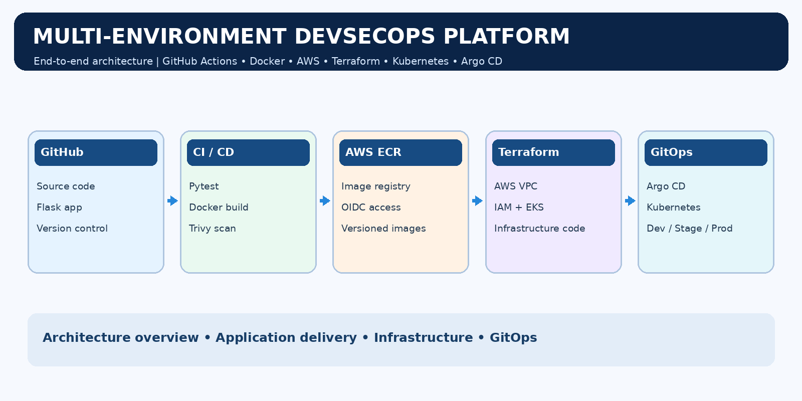
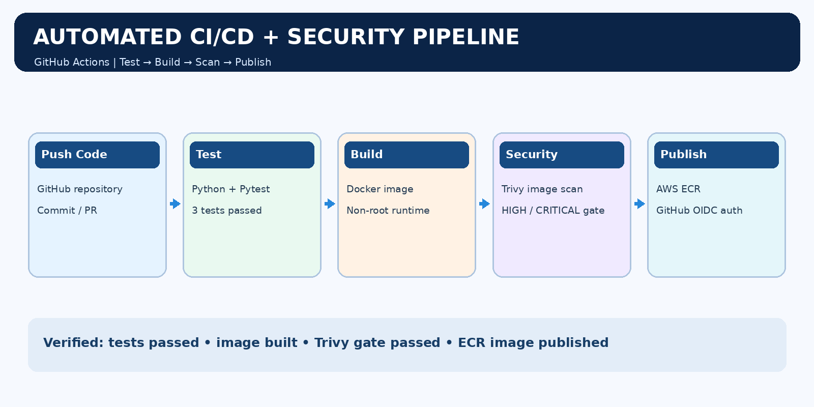
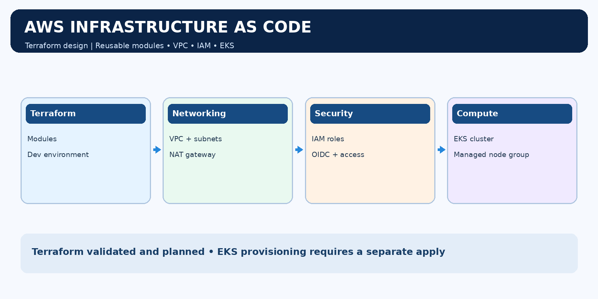
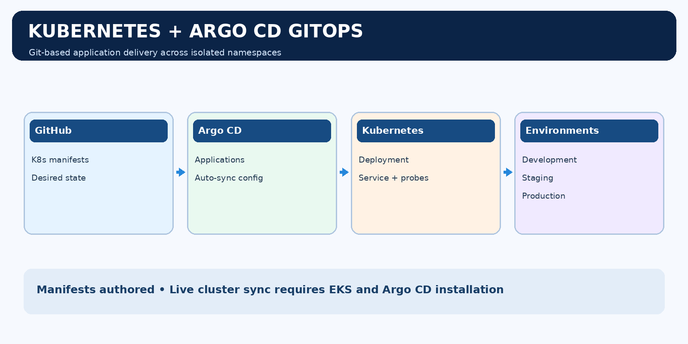
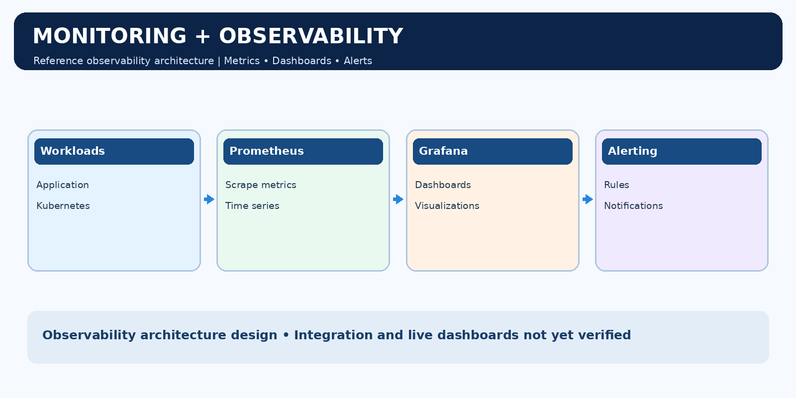

# Multi-Environment GitOps + DevSecOps Platform

**Python · Docker · GitHub Actions · Trivy · AWS ECR · Terraform · Kubernetes · Argo CD**

A portfolio project showcasing a complete **end-to-end DevSecOps architecture**, with automated test/build/scan/publish implemented and infrastructure/GitOps configuration maintained as code.

## Project overview

The platform connects a Python Flask microservice to a secure GitHub Actions pipeline. Commits trigger automated tests, Docker image creation, Trivy vulnerability checks, and publication to Amazon ECR using short-lived GitHub OIDC credentials. Terraform modules define AWS networking and EKS resources. Kubernetes and Argo CD manifests describe application delivery across development, staging, and production namespaces.

## CI/CD workflow

1. Push application code to the GitHub repository.
2. GitHub Actions runs Python unit tests.
3. Docker builds a containerized Flask service.
4. Trivy enforces the configured HIGH/CRITICAL image security gate.
5. GitHub OIDC assumes the AWS IAM role without storing long-lived AWS access keys.
6. The pipeline publishes the image to Amazon ECR.

**Validated:** 3 Python tests passed, Docker health check passed, Trivy scan passed, GitHub Actions CI succeeded, and the ECR image was published.

[View workflow runs](https://github.com/rahul-chaudhari-collab/multi-env-gitops-devsecops/actions)

## AWS infrastructure with Terraform

Terraform modules model VPC networking, public/private subnets, NAT gateway, IAM roles, EKS control plane and managed worker nodes. The Terraform configuration has been validated and an infrastructure plan reviewed. Provisioning is deliberately separate from code validation because AWS resources incur ongoing charges.

## Kubernetes and GitOps

The repository includes a Kubernetes Deployment, ClusterIP Service, readiness and liveness probes, plus Argo CD Application manifests for **development**, **staging**, and **production** namespaces. These files document the GitOps deployment architecture. Cluster creation, application synchronization and multi-environment runtime verification are separate operational steps.

## Monitoring and observability architecture

The observability design uses Prometheus for metrics, Grafana for dashboards and alerting integrations for operational notifications. This is an architecture design, not evidence of installed monitoring services.

## Technology stack

| Layer | Tools |
| --- | --- |
| Application | Python, Flask, Gunicorn, Pytest |
| Container | Docker |
| Security | Trivy |
| CI/CD | GitHub Actions |
| Cloud authentication | GitHub OIDC, AWS IAM |
| Container registry | Amazon ECR |
| Infrastructure as code | Terraform |
| Cloud networking and orchestration | AWS VPC, EKS |
| Kubernetes delivery | Kubernetes manifests, Argo CD Application definitions |
| Observability design | Prometheus, Grafana |

## Repository contents

- `app/` — Flask application and tests
- `docker/` — Dockerfile
- `.github/workflows/` — CI/CD workflow
- `terraform/` — infrastructure configuration and modules
- `kubernetes/base/` — Kubernetes workload and Service definitions
- `kubernetes/argocd/` — GitOps Application manifests
- `assets/` — architecture and workflow illustrations

## Architecture versus runtime verification

This README documents the full platform **design**. Verified running components are the application tests, Docker build/health check, Trivy scan, GitHub Actions CI and ECR publication. Terraform infrastructure and Kubernetes/Argo CD configuration are authored; live EKS, Argo CD synchronization and Prometheus/Grafana dashboards have not been independently verified. Architecture illustrations are not deployment screenshots.

## Interview walkthrough

Start with the architecture diagram, then demonstrate the successful GitHub Actions run and ECR publication. Explain how OIDC avoids static AWS credentials, how Trivy enforces image security, how Terraform describes networking and EKS, and how Argo CD manifests define desired state for each environment. Clearly distinguish tested CI functionality from deployment configuration.

## Author

**Rahul Chaudhari** · [GitHub](https://github.com/rahul-chaudhari-collab)
