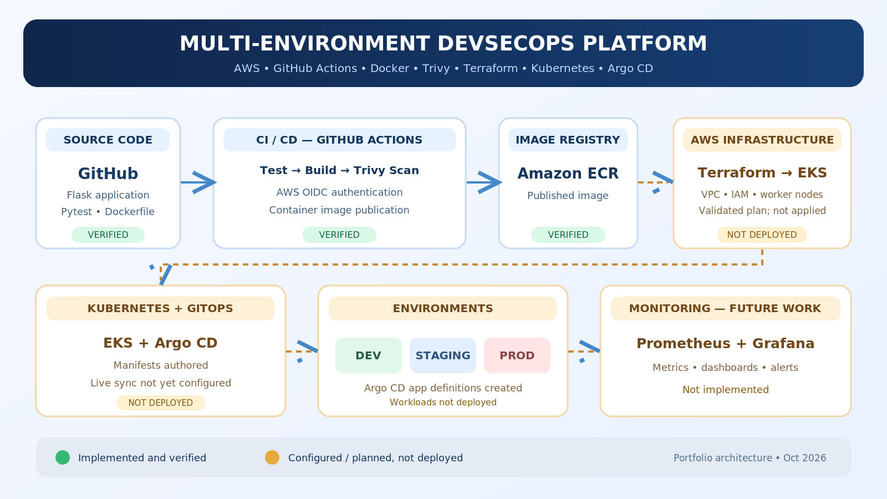

<div align="center">

# Multi-Environment GitOps + DevSecOps Platform

**An AWS-focused DevSecOps portfolio project combining automated testing, container security, AWS ECR, Terraform, Kubernetes manifests, and Argo CD application definitions.**



    

[View CI/CD runs](https://github.com/rahul-chaudhari-collab/multi-env-gitops-devsecops/actions) · [View source](https://github.com/rahul-chaudhari-collab/multi-env-gitops-devsecops)

</div>

> **Deployment transparency:** The application, automated tests, Docker image, Trivy security gate, GitHub Actions pipeline, and ECR publication were verified during development. Terraform EKS infrastructure was validated/planned but **not applied**. Kubernetes and Argo CD YAML files exist but have **not been deployed or synchronized**. Monitoring is future work. This README describes both completed work and the intended architecture without claiming unperformed deployments.

## 1. Project Overview

This project demonstrates a security-aware software delivery workflow: source changes trigger automated tests, container builds and vulnerability scanning, followed by publishing a versioned image to Amazon Elastic Container Registry (ECR). Terraform code defines a proposed AWS network and Amazon EKS cluster. Kubernetes and Argo CD manifests document the intended GitOps deployment design for development, staging and production.

### Goals

- Automate test, build, scan and image publication on GitHub pushes.
- Use short-lived GitHub Actions → AWS authentication through OpenID Connect (OIDC), rather than storing static AWS access keys in CI.
- Package the Flask service in a non-root Docker container with a health endpoint.
- Define AWS infrastructure as code using reusable Terraform modules.
- Prepare GitOps configuration for multiple Kubernetes namespaces.
- Provide an extensible foundation for monitoring and controlled environment promotion.

## 2. Architecture


**Verified path:** `Developer → GitHub → GitHub Actions → Pytest → Docker build → Trivy → AWS ECR`

**Proposed deployment path (not live):** `Terraform → AWS VPC / EKS → Argo CD → Kubernetes namespaces (dev / staging / prod) → monitoring`

## 3. Technology Stack

| Layer | Tools | State |
| --- | --- | --- |
| Application | Python, Flask, Gunicorn | Implemented |
| Testing | Pytest | Passed in development |
| Containers | Docker, multi-stage Dockerfile | Built and health-checked |
| Security | Trivy | HIGH/CRITICAL scan passed in development |
| CI/CD | GitHub Actions | Pipeline previously passed |
| Registry | Amazon ECR | Container image published |
| Cloud authentication | GitHub OIDC + AWS IAM | Configured and used in CI |
| Infrastructure | Terraform, VPC, IAM, EKS | Code validated; EKS not deployed |
| Orchestration | Kubernetes Deployment and Service | Manifests authored; not applied |
| GitOps | Argo CD Applications | Manifests authored; not installed |
| Observability | Prometheus, Grafana | Planned; not implemented |

## 4. Repository Layout

```text
multi-env-gitops-devsecops/
├── .github/
│   └── workflows/
│       └── ci.yml
├── app/
│   └── src/
│       └── app.py
├── docker/
│   └── Dockerfile
├── kubernetes/
│   ├── base/
│   │   └── deployment.yaml
│   └── argocd/
│       ├── dev-app.yaml
│       ├── staging-app.yaml
│       └── prod-app.yaml
├── terraform/
│   ├── modules/
│   └── environments/
│       └── dev/
├── assets/
│   ├── architecture.png
│   └── architecture.svg
└── README.md
```

*Representative layout of the main components. Refer to the repository for the exact complete file tree.*

## 5. Application Endpoints

| Endpoint | Purpose |
| --- | --- |
| `/` | Application response |
| `/health` | Health/readiness check |
| `/info` | Application information |

The containerized service listens on **port 5000**. The Kubernetes Service manifest maps port **80** to container port **5000**.

## 6. CI/CD Pipeline

1. A developer pushes a commit to GitHub.
2. GitHub Actions checks out the source and executes Python tests.
3. Docker builds the container image.
4. Trivy scans the image; the pipeline gates on HIGH/CRITICAL findings.
5. GitHub Actions assumes an AWS IAM role via OIDC.
6. The versioned image is published to Amazon ECR.

**Verified evidence from the build session:** 3/3 Pytest tests passed, the container health check passed, the Trivy scan reported no HIGH/CRITICAL findings, and three GitHub Actions jobs completed successfully. Check the repository's Actions page for current run history.

## 7. Security Design

- **OIDC federation:** CI obtains temporary AWS credentials instead of long-lived CI secrets.
- **Image scanning:** Trivy checks images before registry publication.
- **Non-root runtime:** Docker image runs the service without root privileges.
- **Health probes:** Kubernetes manifests define readiness and liveness checks.
- **Private nodes:** Proposed EKS worker nodes run in private subnets.
- **Restricted API access:** The reviewed EKS Terraform plan restricted public Kubernetes API access to an operator IP range; update that range before any deployment.

**Security note:** The development EC2 workstation currently has broad AWS permissions. Reduce them to least privilege before production use. Review IAM trust policies, Kubernetes RBAC, secrets management, network policies and image-pinning strategy before a real rollout.

## 8. Infrastructure as Code

Terraform code defines a proposed AWS environment including networking, subnets, NAT routing, IAM and an EKS control plane with managed nodes. During development, the reviewed plan showed **24 resources to add, 0 to change and 0 to destroy**. **This plan was not applied.**

```bash
cd terraform/environments/dev
terraform init
terraform fmt -check -recursive
terraform validate
terraform plan
```

These are review commands, not a deployment. Terraform commands require configured AWS credentials and may need environment-specific backend/provider setup. **Do not run `terraform apply` without checking the plan, security and AWS costs.**

## 9. Kubernetes and GitOps

The repository includes a Kubernetes Deployment and ClusterIP Service, plus three Argo CD Application definitions intended for **dev**, **staging** and **prod** namespaces. The applications currently reference a shared Kubernetes base; independent overlays, image promotion, namespace provisioning, access controls and live sync validation remain to be implemented.

```bash
# Examples for a cluster that is already provisioned and configured:
kubectl apply -f kubernetes/base/deployment.yaml
kubectl get deployments,services
```

These commands are **not evidence of an existing deployment**. Argo CD must be installed and configured separately before applying its Application resources.

## 10. Local Development and Validation

```bash
# From the repository root (requires Python and pip):
python3 -m pip install flask gunicorn pytest
python3 -m pytest

# Build the container:
docker build -f docker/Dockerfile -t gitops-devsecops-app .
```

The test and Docker commands above are illustrative; verify the repository's dependency files, Docker build context and CI workflow if you are running from a fresh clone. The CI workflow is the reference for exact tested build commands.

## 11. Verification Checklist

| Check | Result |
| --- | --- |
| Flask application endpoints | Implemented |
| Pytest tests | Passed during development |
| Docker build / health check | Passed during development |
| Trivy image scan | Passed during development |
| GitHub Actions pipeline | Passed during development |
| ECR image publication | Verified during development |
| Terraform configuration | Validated / planned |
| EKS cluster deployment | Not performed |
| Kubernetes application deployment | Not performed |
| Argo CD synchronization | Not performed |
| Prometheus / Grafana | Not implemented |

## 12. Roadmap to a Fully Deployed Platform

- [x] Build the Flask service and automated tests.
- [x] Containerize the service and scan images with Trivy.
- [x] Configure GitHub Actions with AWS OIDC and ECR publication.
- [x] Author and validate Terraform EKS infrastructure code.
- [x] Create Kubernetes and Argo CD manifests.
- [ ] Review AWS costs, access controls and Terraform state backend.
- [ ] Provision EKS and validate worker-node readiness.
- [ ] Install Argo CD and verify sync and application health.
- [ ] Create separate environment overlays and promotion controls.
- [ ] Add Prometheus/Grafana dashboards, alerting and logs.
- [ ] Capture genuine deployment and monitoring screenshots.
- [ ] Run end-to-end rollback and security validation.

## 13. Interview Walkthrough

**Problem:** Manual builds and deployments are error-prone, and security checks are often added too late.

**Approach:** Use GitHub Actions for repeatable testing and container delivery; integrate Trivy as a security gate; authenticate to AWS via OIDC; publish to ECR; define the future Kubernetes infrastructure with Terraform and GitOps configuration with Argo CD.

**What I can demonstrate today:** Application source, passing CI pipeline history, Docker build, vulnerability scan, ECR image and validated infrastructure/manifests.

**What remains before production:** Actual EKS deployment, Argo CD synchronization, environment promotion, monitoring, cost controls and operational hardening.

## 14. Author

**Rahul Chaudhari**  
GitHub: [rahul-chaudhari-collab](https://github.com/rahul-chaudhari-collab)

---


